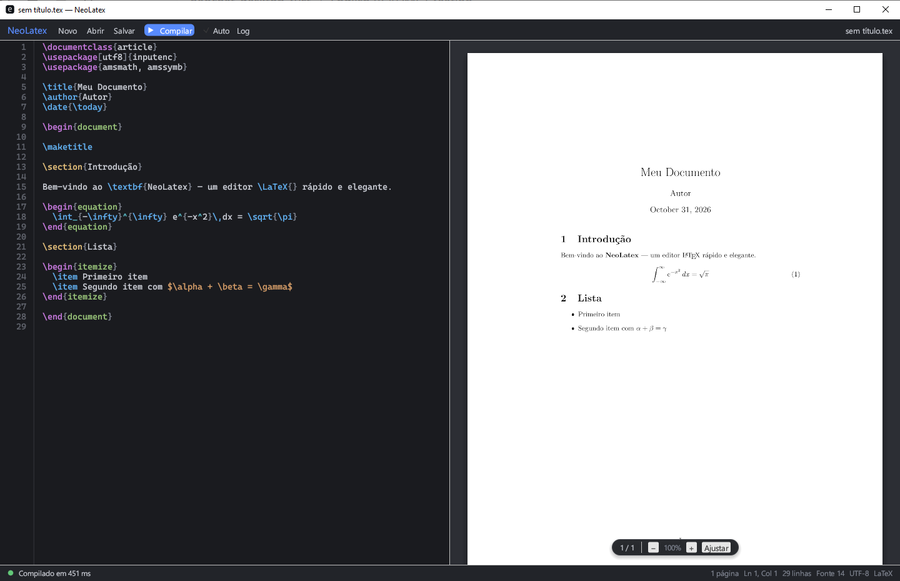

# NeoLatex

Editor LaTeX rápido e elegante, escrito em Rust. O código fica de um lado e o PDF compilado do outro, atualizado enquanto você escreve.



## Recursos

- Editor com realce de sintaxe LaTeX, números de linha e destaque da linha atual
- Preview do PDF ao lado, com zoom (`Ctrl` + rolagem), ajuste à largura e indicador de página
- Compilação em segundo plano, sem travar a interface e sem abrir janela de console
- Recompilação automática ao parar de digitar
- Log de compilação com erros e avisos coloridos
- Arraste um arquivo `.tex` para a janela para abri-lo

## Requisitos

- **Windows** (as fontes e a supressão do console usam recursos do Windows)
- [Rust](https://rustup.rs) (toolchain estável recente)
- Uma distribuição LaTeX com `pdflatex` no `PATH`, como [MiKTeX](https://miktex.org) ou [TeX Live](https://tug.org/texlive/)
- `pdfium.dll` (x64), usado para desenhar o PDF

## Instalação

```bash
git clone https://github.com/giseldo/neolatex.git
cd neolatex
```

Baixe o `pdfium.dll` de [bblanchon/pdfium-binaries](https://github.com/bblanchon/pdfium-binaries/releases) (arquivo `pdfium-win-x64.tgz`, dentro de `bin/`) e coloque-o na pasta do projeto e ao lado do executável. Pelo PowerShell:

```powershell
curl.exe -L -o pdfium.tgz https://github.com/bblanchon/pdfium-binaries/releases/latest/download/pdfium-win-x64.tgz
mkdir pdfium-tmp; tar -xzf pdfium.tgz -C pdfium-tmp
Copy-Item pdfium-tmp\bin\pdfium.dll .
Remove-Item -Recurse -Force pdfium-tmp, pdfium.tgz
```

## Uso

```bash
cargo run --release
```

O executável fica em `target/release/neolatex.exe`. Copie o `pdfium.dll` para essa mesma pasta se for rodá-lo diretamente.

Sem o `pdfium.dll` o editor funciona, mas o painel do PDF mostra uma mensagem de erro.

## Atalhos

| Atalho | Ação |
| --- | --- |
| `F5` | Compilar |
| `Ctrl+S` | Salvar e compilar |
| `Ctrl+O` / `Ctrl+N` | Abrir / novo |
| `Ctrl` + `=` / `-` / `0` | Aumentar / diminuir / restaurar a fonte do editor |
| `Ctrl` + rolagem sobre o PDF | Zoom do preview |

## Tecnologias

[egui](https://github.com/emilk/egui) / eframe para a interface, [pdfium-render](https://github.com/ajrcarey/pdfium-render) para renderizar o PDF e `pdflatex` para compilar.

## Limitações conhecidas

- O documento é compilado em uma pasta temporária; caminhos relativos ao seu `.tex` (`\input`, `\includegraphics`) ainda não são resolvidos.
- As páginas do PDF são renderizadas na thread da interface, então documentos muito longos podem travar por um instante a cada compilação.

## Licença

[MIT](LICENSE)
